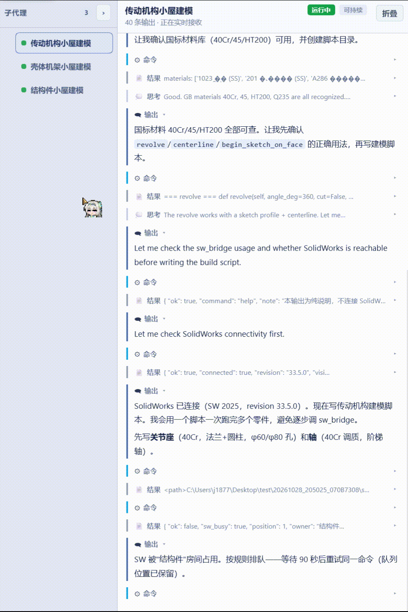

# 🔧 DSH 工程模式 · Engineering Mode


> **面向 CAD / SolidWorks 机械设计的 DeepSeek Harness Agent 预设。**
> 以「完成工图」为唯一目标：需求访谈 → 三维建模 → 有限元校核 → 出图交付，
> 每一道关键闸门都写在 Python 代码里 —— 不通过，流程走不下去。

📦 **长流程产物和日志**：[https://share.feijipan.com/s/tryFb4AU](https://share.feijipan.com/s/tryFb4AU)

**一句话**：它不是一个"帮你写建模脚本的助手"。
它是一个**会自己判断能不能交付**的机械设计工程师。

| 项目 | 值 |
|------|-----|
| 目标平台 | DeepSeek Harness **0.2.x**（Electron 桌面版 / `dsh web`） |
| 预设 ID | `engineering` · 显示名「工程模式」· `order: 4` |
| UI 插件 | `dsh-engineering-ui` **v1.2.0** |
| 技能 | **7** 个 |
| 门禁 / 桥接脚本 | **12** 个核心脚本 + **14** 个物理模块 |
| 回归测试 | **30** 个 Python + **12** 个插件测试 |
| 许可 | MIT |

---

## 🎬 30 秒看完它怎么干活

<p align="center">
  
</p>

> 真实会话录像，**2 倍速**播放（原片约 60 秒）。一句「帮我制造一个机械工厂用的机械臂」进去，
> 出来的是：需求访谈 → 门禁判定 → 拆成多个建模小屋 → 并行驱动 SolidWorks → 汇合总装。
> 后面每一节，就是这段录像里的一环。

---

## 这是什么

DSH 的插件分三个平面，**放错位置会互相连坐**：

| 平面 | 位置 | 内容 | 生效方式 |
|------|------|------|----------|
| **宿主层**（进程级） | `profiles/<profile>/cordis.patch.yml` | 权限预设表、全局服务 | 必须重启 DSH |
| **preset 层**（会话子作用域） | 插件 bundle 里的 `preset-engineering.patch.yml` | 人设、工具、技能 | 热生效 |
| **profile bundle** | `profiles/<profile>/package.json` 的 `dependencies` + `dsh.profile.bundles` | UI 插件（客户端半） | 必须重启 DSH |

> ⛔ **绝对不要把 `- id: permission` 写进 preset。**
> `@deepseek-ai/dsh-permission-presets` 是宿主层进程级服务，preset 里再声明一次 = 重复注册同名服务，
> loader 直接拒绝，后果是**新建会话 / 切预设 / 选模型三件事一起坏**。

> 💡 DSH 0.2.x **不再读取** `.agent-presets` 目录。
> 仓库里的 `engineering/agent.cordis.yml` 只是历史对照，运行时真正加载的是
> 插件 bundle 声明的那份 `preset-engineering.patch.yml`。

### 它能做什么

| 能力 | 实现 |
|------|------|
| 真的驱动 SolidWorks 建模 | Python `win32com`，SW 2018 ~ 2025，单位 mm |
| 自己算有限元 | 纯 Python + numpy（2D CST / 3D CTE），可选 Gmsh / CalculiX / Code_Aster / SW Simulation |
| 疲劳与寿命校核 | Basquin S-N + Marin 修正 + Miner 累积损伤，默认 30 年设计寿命 |
| 出工程图 | 三视图 + 等轴测 → `.SLDDRW` / `.DWG` / `.DXF` / `.PDF`，GB/T 排版规范 |
| 图纸几何校验 | CADX 七项检查（图层 / 图幅 / 线型 / 重叠 / 尺寸链 …） |
| 多零件协作 | 拆分「房间」，子代理串行或并行建模，SW 进程级 FIFO 锁 |
| 判断能不能交付 | 材料 / 物理 / 领域 **三大防线** + 看图证据 + 台账一致性 |

### 三种任务类型（AI 自判，不打扰你）

| 模式 | 场景 | 执行方式 |
|------|------|----------|
| **模式 1** | 单个零件、几何简单 | 单线程直接建模出图 |
| **模式 2** | 多零件 / 机构 / 传动系统 | 门禁流水线 + 多子代理「多屋」协作 |
| **模式 3** | 用户发来图片 / 截图 | 单线程识图、提尺寸、重建、出图 |

三种模式共用同一套 SW / CAD / 物理工具链，区别只在**要不要走门禁、要不要开子代理**。

---

## 🧭 并行策略与搭建方式

<p align="center">
  
</p>

> 门禁启动后的**第一件事**不是让 AI 直接开画，而是先问你两个**互相独立**的问题。
> 这两问写死在 `tools/choice_contract.py` 里，题面和选项由代码给出，AI 不能改写。

### ① 并行策略：多屋是排队还是并行

| 选项 | 含义 | 适合 |
|------|------|------|
| **D** | 部分小屋并行，按波次分批启动 | 零件多、彼此独立、想快 |
| **E** | 单小屋串联，一次一个房间 | 零件之间有强耦合、想稳 |

### ② 搭建方式：这件事你自己能做主吗

| 选项 | 含义 | 交互强度 |
|------|------|----------|
| **A** | 完全自主搭建，AI 自主决策关键尺寸与材料 | 几乎不打扰你 |
| **B** | 部分自主，关键节点询问 | 中等 |
| **C** | 步步确认，**每个零件**建模前都出参数表给你确认 | 最严，全程把关 |

C 模式是**代码级强制**的：每件零件必须单独提问、单独得到答复，
由主对话执行 `mode_gate.py confirm-part <房间> <零件>` 才能写入授权令牌。
沿用上一件零件的确认会被拒绝，并记进 `violations.json`。

### 选定之后

```powershell
python "<根>\tools\workflow_gate.py" select C,E
```

写法很宽松，以下**全部等价**：`select C,E` / `select C E` / `select "C, E"` /
`select c e` / `select --choice C --parallel E`。

`select` 会把结论**当场写进** `workflow_state.json`，并与 `mode_state.json` 自动对齐 ——
不会出现两个命令读到相反结论的情况。

---

## ☑️ 需求是怎么问出来的

> 工程模式的第一条纪律：**不猜参数**。
> 材料、公差、配合类型、载荷来源，不确定就必须问你 —— 但也不是一股脑把几十道题全砸过来。

### 先定「问多细」

门禁第 2 步只问一个问题：**本次任务要不要严格把关参数？**

| 你的回答 | 题数区间 | 说明 |
|----------|----------|------|
| **强需求**（严格校核） | **10 ~ 50** 题 | 载荷、尺寸、公差、材料都要有设计依据 |
| **不强 / 精简** | **5 ~ 10** 题 | 先出大致结构，细节按工程经验定 |

区间由 `mode2_flow.validate_question_budget()` 强制：超上限直接拒绝，
收尾时未达下限同样拒绝交付 —— 既不许敷衍，也不许审问到死。

### 再决定「什么时候问哪一题」

<p align="center">
  
</p>

> 旧做法是开局把候选题目全部抛出，用户答到手软。
> 现在改成**按需提问**：AI 先沿十阶段往下推，推到某个阶段发现缺信息，才问那一题，并写明理由。

> 🆕 十阶段**不再由主对话自己跑**：它由一个真实子代理「总计子代理」推进
> （开工先 `analyst-bind` 绑定自己的 sessionId），主对话只负责编排与建小屋。
> 主对话若自己调 `begin-stage` 会被 `ANALYST_ACTOR_REQUIRED` 拒绝。

十阶段设计流水线（顺序即契约，跳阶段会被拒）：

```
TaskUnderstanding      任务理解      结构化 TaskSpec：目标 / 环境 / 载荷 / 约束 / 未知量
FunctionalDecomposition 功能分解      FunctionTree：子功能 + 输入输出 + 依赖
PhysicsReasoning       物理推导      运动 / 力 / 转矩 / 能量 / 自由度 + 假定
PrincipleSynthesis     工作原理探索  多个候选原理 + 淘汰理由
MechanismSynthesis     机构综合      MechanismGraph：构件 + 连接 + 自由度
RecursivePartReasoning 递归零件推导  PartRequirementGraph：每个零件为何存在
PartSynthesis          零件设计与选型 标准件 / 自定义件 + 几何与接口定义
EngineeringValidation  工程验证      PASS / FAIL / UNKNOWN + 证据
DesignIteration        自主迭代      回退位置 + 版本 + 未解决问题
ExplainableDesignOutput 可解释输出    完整设计报告 + 可追溯性
```

提问必须挂在已经推进到的阶段上：

```powershell
# 1) 先推进阶段（必须按序）
python "<根>\tools\workflow_gate.py" mode2 begin-stage TaskUnderstanding
# 2) 真的缺信息了，才问 —— 且必须写明理由
python "<根>\tools\workflow_gate.py" mode2 ask "使用场合是什么" --stage TaskUnderstanding --reason "决定材料与防护等级"
```

阶段没 `begin-stage` 就提问 → 拒绝；无理由提问 → 拒绝。
这就是「不许开局把题全抛出去」的机器判据。

回答完还要**落盘**（`answer-question`）—— 题目一旦有答复，挂在它上面的阶段产物会立刻标 `stale`，
必须用**新的产物**重做那一段才能继续，防止下游拿着过期参数去建模。

---

## 📏 载荷只有一个来源

曾经踩过一个很典型的坑：门禁按 **1000 N** 估算、physics 按 **100 N** 校核 ——
两套数值，报告当然对不上。

现在载荷只有**一条通路**：

```
门禁问答 ──落盘──> tools/load_cases/gate_load_case.json ──读取──> 有限元 / 疲劳
```

| 规则 | 说明 |
|------|------|
| 优先读用户写的数值 | 「100N」「10kg」「0.1kN」会被直接识别为额定载荷 |
| 冲击只是系数 | 出现冲击 / 动态关键词，只放大**动载系数**，不改额定值 |
| 落盘即真相 | 额定载荷 = `magnitude_n`，physics 严禁另写数值 |
| 估算必须复核 | 返回 `load_is_estimate=true` 时，AI 必须先向你确认才能继续 |

---

## 👥 子代理：主对话只编排，分析交给「总计子代理」

<p align="center">
  
</p>

> 装配体不是一个大脚本能画完的。工程模式把它拆成若干**房间**，
> 每个房间一个子代理，房间之间靠 SW 进程锁排队 —— 而不是靠人盯着。

### 三层角色

| 角色 | 干什么 | 边界 |
|------|--------|------|
| **主对话（大屋）** | 问答、编排、建小屋、收尾 | 不自己跑十阶段；只能调根会话命令 |
| **总计子代理** | `analyst-bind` 后跑十阶段分析、按需提问、决定房间编制 | 只有它能写阶段与编制 |
| **建模小屋 + 总理子代理** | 各自建模；总理同波监工、收上报、校验相邻尺寸 | 只做本房间 |

房间数量**不再固定 3 个**：由总计子代理按分析结论登记（1 ~ 24 个），
每个房间必须写清 `parts`（负责哪些零件）与 `why`（为什么需要它）。
`set-subagent-plan --decided-by 总计子代理` 是硬要求，别人署名直接判越权。

### 波次

| 波次 | 房间 | 干什么 |
|------|------|--------|
| **第 1 波** | 建模小屋 1..N + 总理子代理 | 并行建模；总理与建模**同波启动**，长生命周期监工 |
| **第 2 波** | 总装与验证 | 只有第 1 波**全部** `room-end` 后才允许开始 |
| **第 3 波** | 工程图输出 | 总装完成后出三视图 / 剖视 / 标注 |

### SW 是单实例，所以有一个进程级 FIFO 锁

| 机制 | 行为 |
|------|------|
| 排队 | 谁先请求谁先用，队列保留；返回 `sw_busy` 就等 90 秒重试**同一条命令** |
| 公平轮转 | 有人排队时，单房间最多连续 3 条命令或独占 180 秒，超出强制让位（防饿死） |
| 心跳 | 子代理每 60 秒续一次，但**已降级为辅助证据** |
| 清场 | 每波开始前 `close-all`，确认没有残留的 `SLDWORKS.EXE` |

### 判活只认看板，不认心跳

```powershell
python "<根>\tools\mode_gate.py" room-board --json
```

`room-board` 给每个房间一个**一等状态**，外加 `safe_to_restart` 与 `next_action`：

| 状态 | 含义 | 能不能重启 |
|------|------|-----------|
| `starting` | 刚建，宽限期内 | 否 |
| `running` | 正常干活中 —— **不许说"没反应"** | 否 |
| `waiting_sw` | 在 SW 队列里正常等锁，**不是死了** | **否（严禁判死）** |
| `idle` | 平台侧活着，当前没有可观察动作 | 否 |
| `unbound` | 平台侧活着但忘了 `subagent-assign` | 否，**补绑定即可，禁止 reset** |
| `done` / `failed` | 已收工 / 已失败 | 按需 `recover` |
| `dead` | 真的没了 | **是** —— 唯一允许 `recover/restart` 的状态 |

旧实现的六态分类会把排队等锁的屋子误判成死，于是主对话重启一个其实活着的屋，
两个子代理抢同一份 SW 文件。现在 `waiting_sw` 是一等状态，看板直接给 `safe_to_restart=false`。

### 两条禁令 + 一个例外

1. **小屋不许越权**：建模小屋不能调 `mode_gate` / `workflow_gate` / `list_agents` /
   `subagent_fork`，只做本房间的建模与验证。
   **唯一例外是总计子代理** —— 它只能用 `mode2_flow.py` 的阶段 / 提问 / 编制命令，
   以及 `ask_user.py` 提问桥。
2. **根会话命令不外借**：`init` / `provide_context` / `select` / `confirm-assembly` /
   `recover` / `restart` / `reset` 只许主对话调用，子代理调一律返回 `ROOT_SESSION_REQUIRED`。

这两条都在代码里按 `sessionId` 校验，不是提示词约定 —— 越权不是"不应该"，是**调不通**。

### 小屋自己不会提问，所以有桥

DSH 不允许子代理直接向用户提问（`userQuestions.ask()` 会校验 `agents.roots()`，
子代理必抛 `DELEGATED_CALLER`）。`ask_user.py` 把问题登记到本小屋 → 卡片出现在右侧面板 →
原地阻塞轮询直到你作答 → 答案以 **tool_result** 回到提问方。全程不结束回合。

---

## 🛡️ 三大防线：本项目的核心

这是它和「普通 CAD 助手」最大的区别：**质量校验不是建议，是硬门禁**。

| # | 防线 | 凭据 | 判不通过的依据 |
|---|------|------|----------------|
| ① | **材料** | 每个 `.sldprt` 旁的 `<零件>.SLDPRT.material.json` | 缺凭据 / 密度 = 1000（水）/ 跨标准静默替代 |
| ② | **物理** | `reports/<房间>.physics.json` | `overall == FAIL`，或静力过了但**寿命不够** |
| ③ | **领域** | `reports/<房间>.domain.json` | 存在 CRITICAL 违规（按 GB/T 规则库判） |

### 四个强制点（走到就得过）

```
sw_bridge.py run                 → ① 材料
mode_gate.py room-end <房间>      → ①②③（该房间）+ 看图证据
workflow_gate.py confirm-assembly → ①②③（全部建模房间）
workflow_gate.py select （收尾）  → ①②③（全任务）
```

### 凭据为什么伪造不了

凭据由**宿主进程签名**：HMAC-SHA256，密钥**只存在宿主内存里，绝不落盘**。
Python 侧不持有密钥，签名与验签都得请求宿主；
宿主不可用时不是"放行"，而是 **fail-closed** —— 无法验签即视为未通过。

所以哪怕 AI 能读写工程模式目录里的所有文件，也写不出一份能验签的凭据。
宿主自己会**读磁盘上的真实报告**再签，调用方没法让它为"不存在的运行"背书。

> 签名有效期默认 **24 小时**（`DSH_DEFENSE_SIG_TTL_MS` 可覆盖）。
> 早先设成 10 分钟时，只要一个房间里零件保存跨度超过 10 分钟，
> `room-end` 就必然失败 —— 多零件装配等于永远过不了门。

### 还有一道「你得亲眼看过」

建模房间下线前，本房间产出过的每个零件都必须留下**经核实的看图证据**：
截图真实存在、非 0 字节、闭环判定 PASS。缺任何一件 → `VISUAL_EVIDENCE_REQUIRED`，拒绝下线。

### 唯一合法绕行（且必定留痕）

```powershell
python mode_gate.py room-end "<房间>" --force   # 显式强制
$env:DSH_DEFENSE_BYPASS = 1                     # 环境变量
```

两条路都会写进 `reports/defense_bypass.json` —— 绝不静默放行。

---

## 🔬 物理在环（FEA + 疲劳）

建模不是终点。每个房间都要出一份物理校核报告，`FAIL` 或寿命不足就拒绝下线。

### 求解器的降级链

按本机装了什么自动降级，没有外部 FEA 软件也照样算：

| 级别 | 后端 | 依赖 |
|------|------|------|
| L0 | 解析解（梁理论） | 无 |
| L1 | 纯 Python FEA（numpy CST 三角形 / CTE 四面体） | numpy |
| L2 | Gmsh + CalculiX | 可选安装 |
| L3 | Gmsh + Code_Aster | 可选安装 |
| L4 | Gmsh + Elmer | 可选安装 |
| L5 | SolidWorks Simulation API | SW Premium 许可 |

### 疲劳是必过项，不是加分项

- 方法：**Basquin S-N** + **Marin 修正**（ka/kb/kc/kd/ke）+ Goodman / Soderberg / Gerber 平均应力修正 + **Miner 线性累积损伤**
- 每次 `solve_fea` 之后自动追加，结论并入 `gates` 与 `overall`
- 静力过了但寿命不够 → 直接 `FAIL`，不再误判为 PASS
- 默认按 **30 年**设计寿命；铝合金按无真实疲劳极限处理（5 × 10⁸ 次条件极限）

### 一个闸口只归一层管

同一个闸口 ID 曾出现几何层与 FEA 层给出相反结论的情况。现在 `physics/simulation_report.py` 用
`GATE_OWNER` 给每个闸口声明**唯一归属层**，聚合时只采信归属层：

| 闸口 | 归属 |
|------|------|
| `DESIGN_SPACE` / `CONNECTIVITY` / `WALL_THICKNESS` | 几何层 |
| `SAFETY_FACTOR` / `MAX_DISPLACEMENT` / `FATIGUE` / `MESH_QUALITY` | FEA 层 |

---

## 📐 从模型到图纸

建模阶段只做三件事：草图完全定义 → 特征建模 → 圆角倒角孔。
然后是一条固定链路：`run` → `drawing` → `dwg` → `show`，出图后**截图验收**。

```powershell
python "<根>\tools\sw_bridge.py" run <建模脚本.py>       # 画零件
python "<根>\tools\sw_bridge.py" drawing <零件>          # 出 .slddrw
python "<根>\tools\sw_bridge.py" dwg <零件>              # 导 DWG（AutoCAD 可编辑）
python "<根>\tools\sw_bridge.py" show                    # 截图看一眼
```

工程图含**三视图（前 / 俯 / 右）+ 等轴测**，导出 `.SLDDRW` / `.DWG` / `.DXF` / `.PDF`。

### 排版是硬规则，出界即不合格

画布归一 1.0 × 1.0，原点左下，各纸型同比例。

| 规则 | 值 |
|------|-----|
| 安全区 | `(0.05, 0.05)` ~ `(0.95, 0.95)`，唯一合法区域 |
| 标题栏禁区 | `(0.80, 0.90)` ~ `(1.00, 1.00)` |
| 主视 / 俯视 | `(0.30, 0.72)` / `(0.30, 0.28)` |
| 右视 / 等轴测 | `(0.75, 0.72)` / `(0.75, 0.28)` |
| 投影关系 | 主俯同 x（长对正），主右同 y（高平齐） |
| 视图间距 | 任意两视图 ≥ 35 mm（约 0.04） |

宁可升纸型，也不许越界。轴类零件画中心线（点划线），特征交界画分界线，禁边线重合。

### 两个不商量的小事

1. **命名必须中文**：`DSH_` + 中文名，例如 `DSH_关节轴.sldprt`。
2. **默认材料 Q235**：`new_part()` 就赋材，杜绝「密度恒为 1000（水）」导致的整条校核失真。

---

## 🖥️ 界面：三栏工作区

UI 插件 `dsh-engineering-ui` 只在工程模式下生效，可在设置里关掉。

| 区域 | 内容 |
|------|------|
| **主对话（约 3/4）** | DSH 原生会话区，检测到子代理时自动收窄 |
| **中间竖排频道** | 每个子代理一个按钮，绿点 = 运行中，点击切换右侧屏幕 |
| **右侧工作区（约 1/4）** | 所选子代理的实时输出、工具调用与参数、运行状态、可直接作答的提问卡片 |

没有子代理时三栏全部隐藏，回到全宽聊天。

### 设置页「工程模式」分区

- **工程环境检查**：换电脑后一键扫 Python / pywin32 / numpy / ezdxf / shapely /
  SolidWorks / AutoCAD / 交付目录 / 跨机残留设置，逐项给绿黄红和一行修复建议；
- **生成修复提示词**：用本机实测结果现场生成一段提示词，直接发给新对话让它自己查、自己装；
- **连接区**：SW / CAD 连接探测与启动，状态落 `connection_state.json`，AI 与设置页共读同一份；
- **显示页开关**：可把右侧子代理面板交回 DSH 官方。

---

## 📦 安装

### 环境要求

| 项 | 要求 |
|----|------|
| 系统 | Windows（SolidWorks / AutoCAD 自动化依赖 `win32com`） |
| DSH | **0.2.x**（Electron 桌面版或 `dsh web`） |
| Python | **3.8+ 64 位**，需 `pywin32`；物理校核另需 `numpy` |
| 可选 | `ezdxf` + `shapely`（DXF 几何校验）、`Pillow`（看图）、Gmsh / CalculiX（高阶 FEA） |
| 软件 | SolidWorks 2018 ~ 2025；AutoCAD（仅出 DWG 时需要） |

### 一键安装（DSH 0.2.x）

```powershell
cd <本仓库>
.\install-0.2.0.ps1
# 只装指定 profile：
.\install-0.2.0.ps1 -Profile web,desktop
```

脚本会做四件事：

1. 把 `engineering/tools` 复制到 `~/.dsh/.agent-presets/engineering/tools`（门禁脚本）；
2. 把 `engineering/skills` 复制到 `~/.dsh/skills`（技能）；
3. 把 UI 插件复制进每个 profile 的 `node_modules`，并登记进 `package.json`
   （`dependencies` + `dsh.profile.bundles`）；
4. 写入宿主层 `cordis.patch.yml`（权限三档），**绝不覆盖**已有 patch。

> ⚠️ 装完**必须重启 DSH**。宿主层与插件 host 半都是进程级配置，热更新无效。
> 只改客户端半（`lib/client.js`）时，刷新页面即可。

### 改了代码之后

仓库里的 `engineering/` 是**源码**，DSH 真正加载的是安装副本。改完要同步：

```powershell
.\sync-to-dsh.ps1 -DryRun     # 先看要动哪些文件
.\sync-to-dsh.ps1             # 实际同步（逐个备份 .bak-sync-<时间戳>）
python engineering\tools\verify_sync.py   # 逐文件 SHA-256 比对，确认真的同步了
```

> 运行时状态文件（`mode_state.json` / `workflow_state.json` / `sw_state.json` /
> `connection_state.json` / `settings.json`）是**会话现场数据**，同步时会被跳过 ——
> 不要手动覆盖，否则流程会误判。

---

## ⌨️ 命令速查

> 门禁的入口全是**命令行脚本**，不是 DSH 工具。
> 历史文档里出现过的 `workflow-gate-init` 这类"工具名"在本环境并不存在，照抄会失败。

```powershell
$T = "<工程模式根目录>\tools"   # 含 mode_gate.py 与 workflow_gate.py 的那个目录
python "$T\_root.py"            # 不确定根目录？先跑这个自检
```

### `workflow_gate.py` — 门禁大脑

| 子命令 | 用途 |
|--------|------|
| `init "<任务>"` | 初始化任务，返回第 1 步（模式确认 + 并行策略 D/E + 搭建方式 A/B/C） |
| `provide_context "<回答>"` | 推进状态机，**需调用 3 次**（模式确认 → 需求强度 → 汇总估算） |
| `select C,E` | 锁定搭建方式与并行策略 |
| `confirm-assembly "<清单>"` | 第 1 波完成后确认总装 |
| `check-part` / `verify-ownership` | 零件归属校验 / 总装前去重核对 |
| `status` / `gate-summary` / `check` | 状态 / 总览 / 是否允许建模 |
| `recover` / `restart <房间>` / `reset` | 恢复卡住 / 重做房间 / 清空重来 |
| `mode2 <子命令>` | 十阶段契约：`begin-stage` / `ask` / `prime-report` / `prime-verify` … |
| `stage-status` / `pre-delivery` | 阶段进度 / 交付前总闸 |

> 除 `status` / `gate-summary` 这类只读命令外，**只许根会话调用**；
> 子代理调 `init` / `select` / `reset` 会拿到 `ROOT_SESSION_REQUIRED`。

### `mode_gate.py` — 房间状态机 + SW 锁

| 类别 | 子命令 |
|------|--------|
| **看板（权威）** | `room-board [--room X] [--json]` — 八态 + `safe_to_restart` + `next_action` |
| 房间 | `room-start` / `room-end` / `room-fail` / `room-status` / `room-report` / `room-report-read` |
| SW 锁 | `sw-request` / `sw-wait` / `sw-release` / `sw-status` / `sw-proc` / `lock-doctor` / `close-all` |
| 子代理 | `subagent-assign`（**每次 fork 后必做**） / `subagent-free` / `subagent-status` / `whoami` |
| 心跳 | `room-heartbeat`（辅助证据） / `room-heartbeat-check` |
| 授权 | `confirm-part <房间> <零件>`（C 模式） / `room-artifact` |
| 看护 | `sw-guard-start` / `sw-guard-stop` / `sw-guard-status`（CPU / 内存 > 85% 立刻关 SW） |
| 维护 | `doctor` / `rooms-reset` / `stale-artifacts` / `residue-check` / `platform-refresh` |

### `mode2_flow.py` — 十阶段 / 编制 / 总理

| 子命令 | 用途 |
|--------|------|
| `analyst-bind` / `analyst-status` | 总计子代理绑定自己的 sessionId / 查看是否已绑定 |
| `begin-stage` / `mark-stage-done` | 按序推进阶段 / 登记产物（只认总计子代理身份） |
| `ask` / `answer-question` / `refresh-stage` | 按需提问 / 落盘答复 / 重做过期阶段 |
| `set-subagent-plan --rooms-json ... --decided-by 总计子代理` | 登记本轮房间编制 |
| `prime-board` / `prime-report` / `check-consistency` | 监工看板 / 收上报 / 相邻尺寸一致性 |
| `prime-verify` / `export-docx` / `pre-delivery` | 统一核实 / 汇总 docx / 交付前总闸 |

### 其他脚本

| 脚本 | 用途 |
|------|------|
| `defense_gate.py check-room <房间>` / `check-task` | 三大防线自查 |
| `sw_bridge.py <命令>` | SW 桥接（`run` / `drawing` / `dwg` / `physics-*` / `conn-*` / `cad-*`） |
| `physics_bridge.py <子命令>` | 物理验证 CLI（`validate-case` / `optimize` / `fatigue` / `validate-domain`） |
| `visual_check.py gate --part <零件> --expect <json>` | 看图闭环校核 |
| `ask_user.py --room <房间> --child <id> ...` | 子代理阻塞式提问 |
| `part_registry.py` | 零件台账：相邻尺寸一致性 / SHA-256 防篡改 / 导出 docx |
| `settings.py report` / `env_check.py probe` | 本机设置 / 环境自检 |

---

## 🗂️ 目录结构

```
DSH-SW-and-CAD-main/
├── README.md                     # 本文件
├── assets/gifs/                  # 四段实录动图
├── install-0.2.0.ps1             # DSH 0.2.x 安装（装进所有 profile）
├── install.ps1 / install.sh      # DSH 0.1.x 安装（Win / macOS-Linux）
├── sync-to-dsh.ps1               # 源码 -> 安装副本同步
├── patch-incompatible.ps1        # 第三方插件 peer range 修补
├── RUNNING_WORKFLOW.md           # 源码级全链路追踪（从一条消息到一次 COM 调用）
├── engineering/                  # ★ 预设本体
│   ├── preset.yml                # 显示元数据
│   ├── agent.cordis.yml          # 历史清单（运行时不加载，仅对照）
│   ├── README.md                 # 架构与门禁细节（更技术向）
│   ├── skills/                   # 7 个技能
│   │   ├── mode-selection/       # 强制入口：模式选择 + 门禁流程
│   │   ├── assembly-orchestration/ # 多屋编排
│   │   ├── cad-workflow/         # AutoCAD 工作流
│   │   ├── sw-design/            # SW 设计 + GB/T 制图
│   │   ├── solidworks-bridge/    # SW 桥接
│   │   ├── sw-to-cad/            # SW -> CAD
│   │   └── physics-in-loop/      # 物理在环
│   ├── tools/                    # ★ Python 工具链
│   │   ├── workflow_gate.py      # 门禁大脑
│   │   ├── mode_gate.py          # 房间状态机 + SW 锁 + room-board
│   │   ├── mode2_flow.py         # 十阶段契约 / 编制 / 总理
│   │   ├── defense_gate.py       # 三大防线
│   │   ├── sw_bridge.py          # SW 桥接执行器
│   │   ├── swapi.py              # 高层建模 API
│   │   ├── part_registry.py      # 零件台账 + 一致性校验
│   │   ├── visual_check.py       # 看图闭环
│   │   ├── physics/              # 物理子系统（FEA / 疲劳 / 规则库）
│   │   ├── physics/rules/        # GB/T 规则包
│   │   ├── load_cases/           # 载荷工况（gate_load_case.json）
│   │   ├── reports/              # 防线凭据 + 房间报告
│   │   └── test_regression_*.py  # 30 个回归测试
│   └── plugins/dsh-engineering-ui/  # UI 插件
│       ├── lib/index.js          # Host 半（HTTP 路由 / 提问桥接 / 防线签名）
│       ├── lib/client.js         # 浏览器半（三栏工作区）
│       ├── lib/defense-sign.js   # HMAC 凭据签名
│       ├── preset-engineering.patch.yml  # ★ 运行时真正加载的人设
│       └── test/                 # 12 个插件测试
├── profiles/                     # 宿主层 patch 模板
└── third-party-patched/          # 打过补丁的第三方插件
```

> 动手改之前先读 `engineering/README.md`：那里记着每个历史 bug 的**现场现象 / 根因 / 修复判据**，
> 很多看起来"多余"的代码，是为了防止某个已经踩过两次的坑复发。

---

## ⚠️ 已知限制

1. **强依赖 Windows + 已装好的 SolidWorks**。SW / CAD 自动化走 COM，macOS 与 Linux 上只能跑非建模部分。
2. **没装 SolidWorks 的机器上，SW 相关行为无法验证**（`massprops`、`GetBodyBox` 等）。
3. **CADX 的重叠检查依赖 `ezdxf` + `shapely`**，两者缺失时该项自动跳过 —— 别把它当成"已通过"。
4. **铝合金按无真实疲劳极限处理**（用 5 × 10⁸ 次条件极限），校核偏保守。
5. **规则库是元数据注册表 + 适用性提示**：具体机读数值仍需从标准原文提取；
   BLOCKER / CRITICAL 类规则必须人工复核，不可由 AI 自动放行。
6. **部分文件是 UTF-8 with BOM**。Windows PowerShell 5.1 的 `Get-Content` 会按 ANSI 解码，
   读中文 JSON 容易报「传入的对象无效」。用 `python -c "..."` 或 DSH 的 read 工具读。
7. **四段动图合计约 13 MB**，GitHub 首屏加载会慢一些；介意的话可以换成压缩版或外链。

---

## 📜 版本历史

| 提交 / 日期 | 说明 |
|-------------|------|
| 2026-10-28 | **总计子代理真实化**（`analyst-bind` + 身份校验）+ 总理子代理同波启动与监工 + `room-board` 状态可信化（`waiting_sw` / `unbound`）+ 子代理禁令（`ROOT_SESSION_REQUIRED`）+ 插件自动平台登记 |
| `e12d665` | 为移动端 DSH Go 做适配性调整 |
| `fe671a3` | mode2_flow 与防御门控完善，新增回归测试与物理运行记录 |
| `b2a11b1` | **已适配 DSH 0.2.1-rc.2** |
| `578818e` | 模式二流程改造：十阶段契约 + 总理核实 + 看图闭环 + SW 双路看护 |
| `eb55f4a` | 适配 DSH 0.2.0 桌面版（bundle 路径、desktop profile、三栏 UI） |
| `d2e6828` | 工程工作流更新：技能、mode gate、插件、SW 桥接改进 |

---

## English

**DSH Engineering Mode** is an Agent Preset for [DeepSeek Harness](https://github.com/deepseek-ai/dsh/),
built for CAD / SolidWorks mechanical design. Its single goal is a **finished engineering drawing**.

What makes it different from a chat assistant that writes CAD scripts:

| | |
|---|---|
| **Real SolidWorks automation** | Python `win32com`, SW 2018 ~ 2025, millimetres |
| **Built-in FEA** | pure-Python CST / CTE solver, optional Gmsh / CalculiX / Code_Aster / SW Simulation |
| **Fatigue by default** | Basquin S-N + Marin + Miner, 30-year design life |
| **Three defense lines** | material / physics / domain, enforced by **host-signed HMAC credentials** |
| **Multi-room subagents** | assembly split into rooms, process-level FIFO lock around SolidWorks |
| **Gated workflow** | analyst subagent runs a ten-stage pipeline, then a pre-delivery check |
Quick start (Windows, DSH 0.2.x):

```powershell
.\install-0.2.0.ps1      # install preset + skills + UI plugin
# then restart DSH
```

Requirements: Windows, DSH 0.2.x, Python 3.8+ (64-bit) with `pywin32`, SolidWorks 2018 ~ 2025.
Optional: `numpy` (physics), `ezdxf` + `shapely` (DXF validation), `Pillow` (visual check).

The preset ships a Chinese persona out of the box. The tooling, gate scripts and HTTP routes
are language-neutral; see `engineering/README.md` for the architecture notes.

---

## License

MIT — 见 [LICENSE](LICENSE)。

本项目是 DeepSeek Harness 的**第三方 Agent 预设**，与 DeepSeek 官方无隶属关系。
SolidWorks 与 AutoCAD 分别是 Dassault Systèmes 与 Autodesk 的商标，本项目仅通过其公开 COM 接口进行自动化调用。
